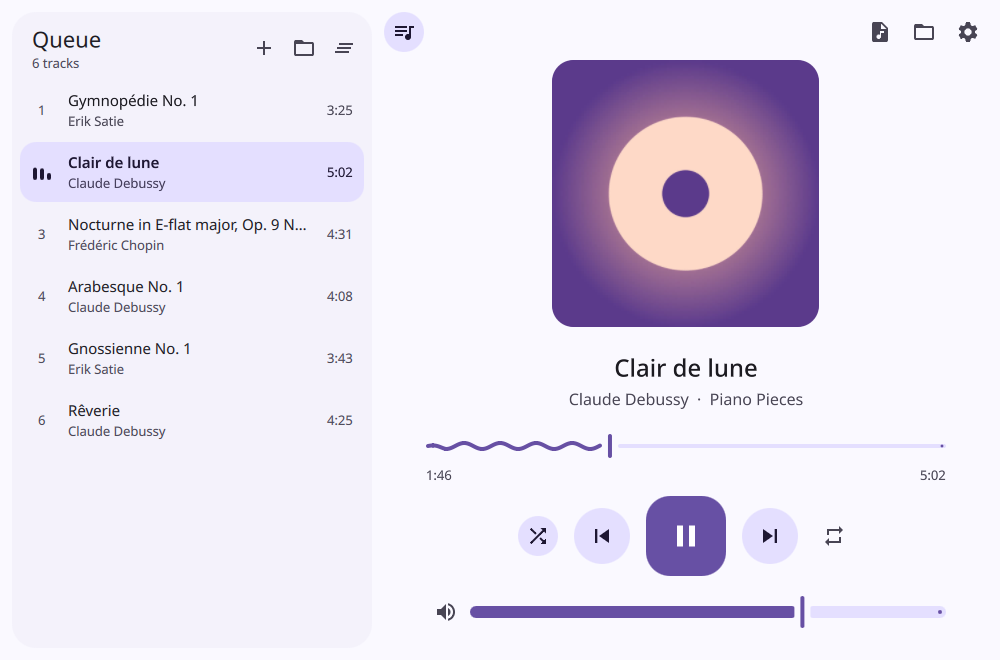
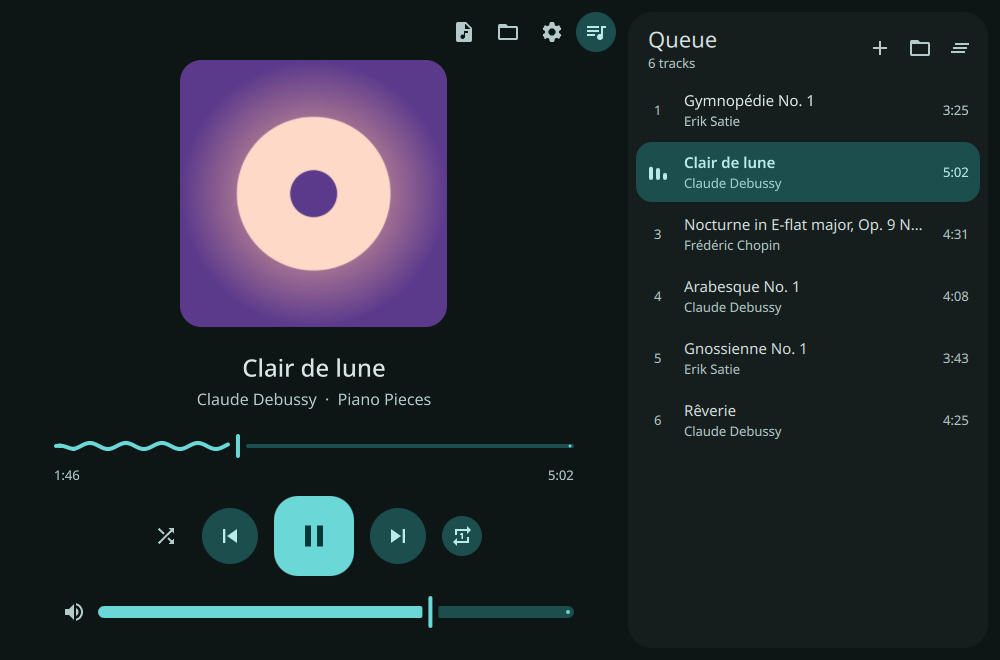
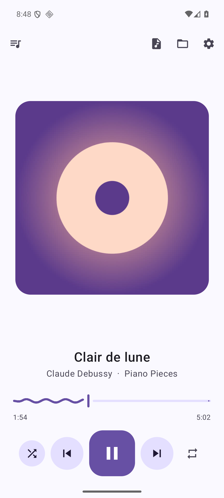
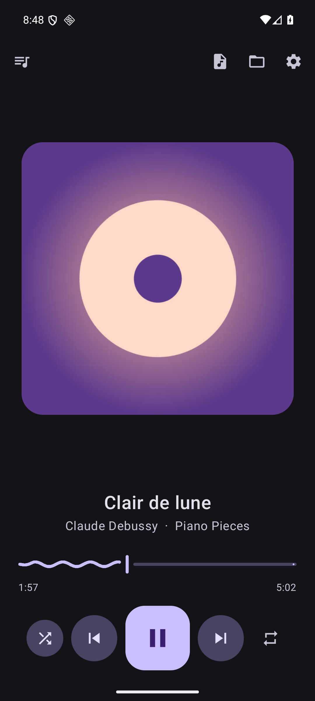
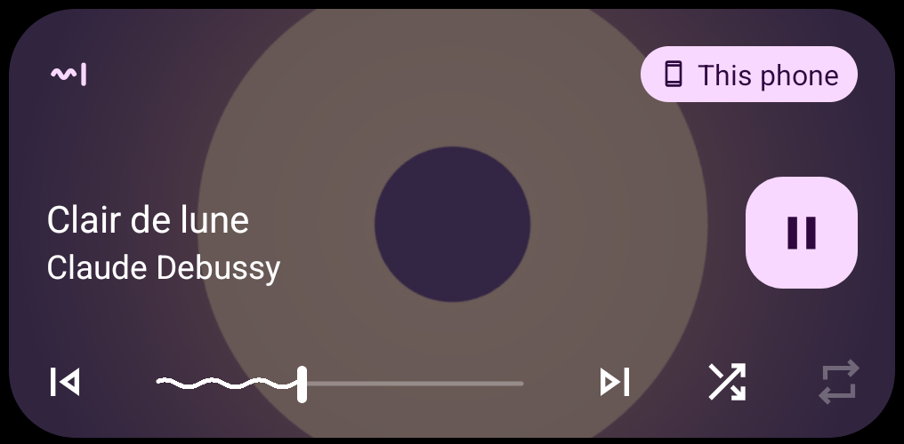

# Kvant

A clean, lightweight audio player for Linux and Android with a Material 3 look: the squiggly
progress line, a morphing play button and a full color scheme generated from one accent color.

<p align="center">
  
  
</p>
<p align="center">
  
  
  
</p>

## Features

- Play a single file, or open a folder (it's scanned recursively) as a queue
- Queue panel you can put on the left or right, or collapse
- Shuffle, repeat all and repeat one. They're remembered between runs
- Picks up where you left off: the queue, track and position are restored (paused) when you start Kvant again.
  On Android, a headset or Bluetooth play button resumes it even when the app is closed
- Squiggly progress bar that settles into a flat line when paused. You can set its height, wavelength and speed, or switch it off
- Light / Dark / follow system theme, with any accent color
- Drag & drop files and folders onto the window to add them to the queue
- MPRIS support: media keys, desktop media widgets, `playerctl` (including shuffle and loop)
- On Android: notification and lock screen controls with shuffle and repeat buttons. These are also
  what the phone's "island" widgets show (Samsung's Now Bar, Xiaomi's Super Island and similar)
- Single instance: "Open with Kvant" in a file manager reuses the open window
- Embedded cover art, or `cover.jpg` / `folder.jpg` next to the files

## Install

Download links are on the [latest release](https://github.com/proshiv85-byte/kvant/releases/latest).

### Arch Linux (AUR)

Kvant is on the AUR as [`kvant`](https://aur.archlinux.org/packages/kvant):

```sh
yay -S kvant      # or: paru -S kvant
```

### Debian / Ubuntu (.deb)

For Debian 13 (trixie) and Ubuntu 26.04 or newer:

```sh
sudo apt install ./kvant_*_amd64.deb
```

Older releases (like Ubuntu 24.04) ship a Qt that's too old. Use the AppImage or Flatpak there.

### Fedora (.rpm)

The file name says which Fedora version it was built for (e.g. `fc44` = Fedora 44). It works on that version and newer:

```sh
sudo dnf install ./kvant-*.rpm
```

### Flatpak (any distro)

```sh
flatpak install --user ./Kvant-*.flatpak
flatpak run io.github.proshiv85_byte.Kvant
```

Needs the Flathub remote, which provides the KDE runtime. If you don't have it, add it first:
`flatpak remote-add --user --if-not-exists flathub https://dl.flathub.org/repo/flathub.flatpakrepo`

### AppImage (any distro)

Qt is bundled, so it also runs on older distros:

```sh
chmod +x Kvant-*-x86_64.AppImage
./Kvant-*-x86_64.AppImage
```

### Android

Download `Kvant-*.apk` from the release and open it on your phone. You may need to allow
installing apps from your browser or file manager. Requires Android 8.0 or newer.

## Building from source

Dependencies: Qt ≥ 6.8 (base, declarative, multimedia + a backend such as
`qt6-multimedia-ffmpeg`), TagLib ≥ 2.0, CMake.

```sh
cmake -S . -B build -G Ninja -DCMAKE_BUILD_TYPE=Release -DCMAKE_INSTALL_PREFIX=/usr
cmake --build build
sudo cmake --install build
```

Run without installing: `./build/kvant [files or folders…]`

### Android app

The Android app (Kotlin + Jetpack Compose, in `android/`) needs JDK 17+ and the Android SDK:

```sh
cd android
./gradlew assembleDebug    # → app/build/outputs/apk/debug/app-debug.apk
```

## Keyboard shortcuts

| Key | Action |
| --- | --- |
| Space | Play / pause |
| ← / → | Seek 5 s |
| Ctrl+← / Ctrl+→ | Previous / next track |
| Ctrl+S | Shuffle on / off |
| Ctrl+R | Repeat: off → all → one |
| Ctrl+O | Open files |
| Ctrl+Shift+O | Open folder |
| Ctrl+, | Settings |
| Ctrl+Q | Quit |

## Fonts

Kvant uses *Google Sans Flex*, *Google Sans*, *Roboto Flex* or *Roboto* if one of them is
installed, and otherwise falls back to your system font.

## License

GPL-3.0-or-later. Icons are from Google's Material Icons (Apache-2.0).
